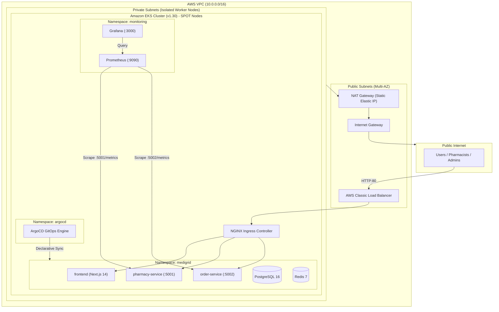

# MediGrid — AWS Cloud Infrastructure, GitOps & Monitoring Stack

[](https://github.com/albin8800/medigrid-infra/releases/tag/v1.0.0)
[](https://www.terraform.io)
[](https://kubernetes.io)
[](https://argo-cd.readthedocs.io)
[](https://prometheus.io)

This repository contains the complete **Infrastructure as Code (Terraform)**, **Kubernetes Manifests**, **GitOps CD (ArgoCD)**, and **Observability Stack (Prometheus & Grafana)** for the MediGrid platform.

---

## 1. Cloud Architecture (AWS Sydney `ap-southeast-2`)



---

## 2. Directory Layout

```text
medigrid-infra/
├── terraform/                  # Infrastructure as Code (AWS EKS, VPC, ECR)
│   ├── vpc.tf                  # Multi-AZ VPC, subnets, route tables, and IGW
│   ├── nat.tf                  # Elastic IP, NAT Gateway, private routing
│   ├── eks.tf                  # EKS Control Plane v1.30 & SPOT Node Group
│   ├── ecr.tf                  # Private container repositories
│   └── variable.tf             # Environment inputs and CIDR definitions
│
├── k8s/                        # Production Kubernetes Manifests
│   ├── 00-namespace.yaml       # MediGrid namespace
│   ├── 01-config-secrets.yaml  # Environment configuration and secrets
│   ├── 02-database-init.yaml   # PostgreSQL schema & automated table seeding
│   ├── 03-databases.yaml       # PostgreSQL 16 & Redis 7 deployments
│   ├── 04-microservices.yaml   # pharmacy-service and order-service deployments
│   ├── 05-frontend.yaml        # Next.js 14 frontend deployment
│   ├── 06-ingress.yaml         # Ingress routing rules & path mappings
│   └── 07-monitoring.yaml      # Prometheus & Grafana monitoring stack
│
└── argocd/                     # GitOps Continuous Delivery
    └── medigrid-application.yaml # Declarative ArgoCD Application CRD
```

---

## 3. GitOps Continuous Delivery (ArgoCD)

The cluster runs a declarative ArgoCD application that monitors this repository:
* **Repository**: `https://github.com/albin8800/medigrid-infra.git`
* **Target Revision**: `main` / `develop`
* **Path**: `k8s/`
* **Sync Policy**: Automated with `prune: true` and `selfHeal: true`. Any commit merged into Git automatically reconciles to the live cluster within seconds.

---

## 4. Observability & Monitoring

* **Prometheus**: Automatically discovers and scrapes `/metrics` endpoints from `pharmacy-service:5001` and `order-service:5002` every 15 seconds.
* **Grafana**: Pre-configured with Prometheus as default data source (`http://prometheus.monitoring.svc.cluster.local:9090`).
  - Default User: `admin`
  - Default Password: `medigrid2026`

---

## 5. Cost-Optimization & Operational Runbook

### Clean Teardown (Freeze Spend to $0.00)
When testing is complete, destroy billable compute while keeping free VPC networking and ECR images:

```bash
# 1. Release the AWS Load Balancer
kubectl delete -f k8s/06-ingress.yaml
kubectl delete -f https://raw.githubusercontent.com/kubernetes/ingress-nginx/controller-v1.10.0/deploy/static/provider/aws/deploy.yaml

# 2. Terminate EKS Master, Worker Nodes, and NAT Gateway
cd terraform
terraform destroy \
  -target=aws_eks_node_group.main \
  -target=aws_eks_cluster.main \
  -target=aws_route_table.private \
  -target=aws_nat_gateway.main \
  -target=aws_eip.nat \
  -auto-approve
```

### Instant Spin-Up (Recreate in ~12 mins)
```bash
# 1. Provision Infrastructure
cd terraform && terraform apply -auto-approve

# 2. Update Kubeconfig & Deploy NGINX Ingress
aws eks update-kubeconfig --region ap-southeast-2 --name medigrid-dev-eks
kubectl apply -f https://raw.githubusercontent.com/kubernetes/ingress-nginx/controller-v1.10.0/deploy/static/provider/aws/deploy.yaml
kubectl annotate svc ingress-nginx-controller -n ingress-nginx \
  service.beta.kubernetes.io/aws-load-balancer-type- \
  service.beta.kubernetes.io/aws-load-balancer-backend-protocol- \
  service.beta.kubernetes.io/aws-load-balancer-cross-zone-load-balancing-enabled-

# 3. Deploy Workloads & Restore Database
kubectl apply -f k8s/
cat ../backups/medigrid_db_backup.sql | \
  kubectl exec -i $(kubectl get pod -n medigrid -l app=postgres -o jsonpath='{.items[0].metadata.name}') -n medigrid \
  -- psql -U medigrid -d medigrid_db
```
